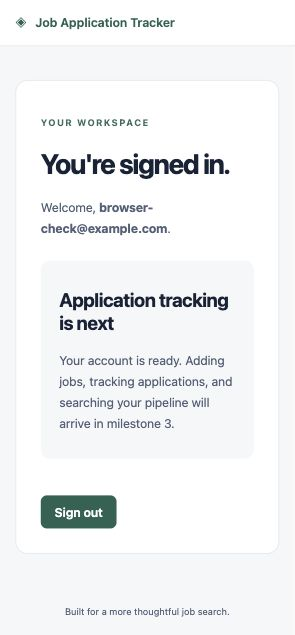

# Job Application Tracker

A full-stack job-search workspace built with React/TypeScript, FastAPI,
SQLAlchemy, and PostgreSQL. Designed as a modular monolith with durable
application history, reproducible job analysis, and explainable matching.

## Current status

**Milestones 1–4: foundation, authentication, core tracking, and history implemented.**

Implemented: project structure, 11-table schema, Alembic migration, database
constraints, health endpoints, local Docker configuration,
backend tests, and CI configuration. Registration, login, session restoration,
CSRF-protected logout, and React account screens are available. Company/job/application
management now includes forms, description versions, archive/restore, notes,
search, filters, sorting, and pagination. Application timelines record stage/outcome
changes transactionally, and immutable document metadata can be attached to applications.

Not implemented: dashboard metrics, file uploads, extraction, matching, or production deployment. Their tables
exist to establish the approved relational design; no feature is simulated.

## Run with Docker

Requires Docker with Compose.

```sh
cp .env.example .env
docker compose up --build
```

Open http://localhost:5173 and API documentation at http://localhost:8000/docs.
Compose waits for PostgreSQL health and successful migration before starting
FastAPI. Database data persists in a named volume. `docker compose down` stops
services without deleting data. Development ports bind only to localhost.

The example password is for local development only. If changing it, use a
URL-safe password or supply a correctly percent-encoded database URL. The
Compose setup uses a frontend development server, not production hosting.

## Run without Docker

Use Python 3.12+, Node 22+, and PostgreSQL 14+ (Compose/CI use PostgreSQL 17).
Create a database and account first, then configure `DATABASE_URL` in `.env`.

```sh
python3 -m venv backend/.venv
backend/.venv/bin/pip install -r backend/requirements-dev.lock
backend/.venv/bin/pip install --no-deps -e backend
```

Run these from `backend/`; copy the root `.env` to `backend/.env` first so both
Alembic and FastAPI use the same settings:

```sh
.venv/bin/alembic upgrade head
.venv/bin/uvicorn app.main:app --reload
```

In a second terminal, from `frontend/`:

```sh
npm ci
npm run dev
```

Vite proxies `/api` to localhost:8000; Compose overrides the target to the
backend container. No cross-origin browser API access is required.

## Verification

From `backend/`:

```sh
.venv/bin/ruff check .
.venv/bin/ruff format --check .
.venv/bin/pytest
```

Without `TEST_DATABASE_URL`, database tests are explicitly skipped. To run them,
create a **disposable** database, set both `DATABASE_URL` and
`TEST_DATABASE_URL` to its URL, and run:

```sh
.venv/bin/alembic upgrade head
.venv/bin/alembic check
.venv/bin/pytest
```

CI provisions PostgreSQL and also verifies downgrade to base and re-upgrade.
Never downgrade a real application database merely to test migrations.
Authentication integration tests use PostgreSQL savepoints and roll back their changes.
From `frontend/`, `npm run build` performs TypeScript checking and a Vite build.
`npm run format:check` checks formatting; `npm run format` applies it.
Python dependency versions are captured in `backend/requirements-dev.lock`;
frontend versions are captured in `frontend/package-lock.json`.

## Architecture and schema

See [architecture](docs/architecture.md), [schema](docs/schema.md),
[metric definitions](docs/metrics.md), [management behavior](docs/management.md),
[history and document behavior](docs/history.md), and [milestones](docs/milestones.md).

The backend follows SQLAlchemy's [declarative mapping documentation](https://docs.sqlalchemy.org/en/20/orm/declarative_tables.html)
and FastAPI's [testing documentation](https://fastapi.tiangolo.com/tutorial/testing/).

## Authentication

- `POST /api/v1/auth/register`: creates an account and session.
- `POST /api/v1/auth/login`: verifies credentials and issues fresh session cookies.
- `GET /api/v1/auth/me`: returns the authenticated user's safe account fields.
- `POST /api/v1/auth/logout`: verifies CSRF and revokes the current session.

Use the frontend to create an account and sign in. Passwords must be 12–128
characters. API clients must send `X-Requested-With: job-tracker` for mutations
and `X-CSRF-Token` from the CSRF cookie for logout. No paid/external service is
required. No schema migration was needed: the foundation already included users
and sessions.

See [security decisions and limitations](docs/security.md). Production must
set `ENVIRONMENT=production` and `ALLOWED_ORIGINS` to an explicit JSON array of
HTTPS origins, with same-origin frontend/API routing. The Compose configuration
remains a local development setup.

## Security and deployment status

Authentication now uses Argon2id, opaque hashed sessions, HttpOnly cookies,
server-side expiry/revocation, CSRF validation, sanitized validation errors,
and a bounded per-process login/registration throttle.

Environment files are ignored by Git. Database errors in readiness responses
are sanitized. Database ownership constraints are defense in depth; they do
not replace authentication and user-scoped queries.

Production hosting, TLS, reverse proxy configuration, backup/restore procedures,
and screenshots of the completed tracking product remain future work.

## Authentication preview

Verified in a browser using a synthetic local test account:



## Application management preview


## Application history preview


