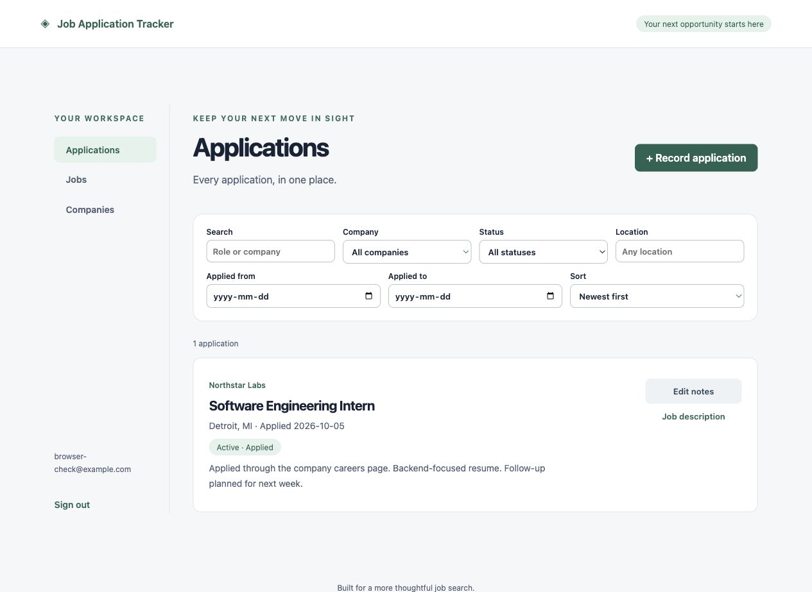
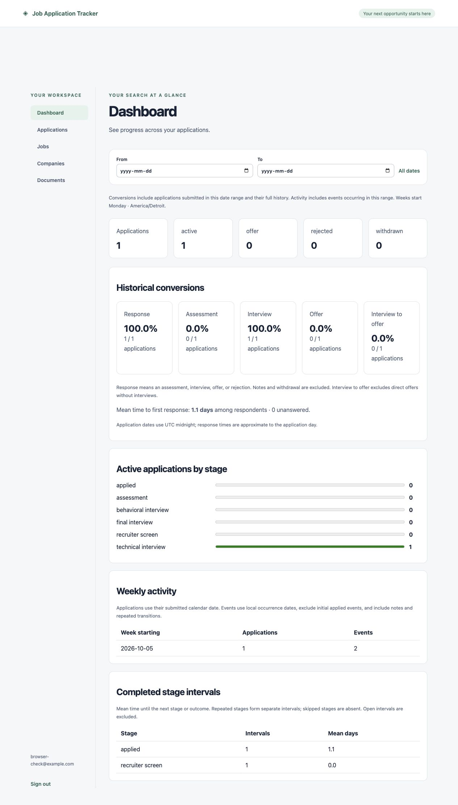

# Job Application Tracker

A full-stack job-search workspace built with **React, TypeScript, FastAPI,
SQLAlchemy, and PostgreSQL**. Track applications and interview history, analyze
job descriptions with source evidence, and compare requirements against a profile
using explainable scoring.

## Features

- **Account isolation:** Argon2id password hashing, server-side sessions,
  HttpOnly cookies, CSRF protection, and ownership checks.
- **Job and application management:** companies, job postings, notes, search,
  filters, sorting, pagination, and reversible job archiving.
- **Durable history:** immutable description versions and application events;
  transactional stage/outcome updates with row locking.
- **Document references:** attach resume and cover-letter version metadata.
- **Dashboard:** historical conversion rates, response time, weekly activity,
  current statuses, and active stages, with documented date/timezone semantics.
- **Deterministic extraction:** a provider interface, limited skill vocabulary,
  structured requirements, exact source spans, and immutable analysis versions.
- **Explainable matching:** revisioned profiles, weighted skill coverage, tagged
  project/experience evidence, and saved input snapshots and score breakdowns.

## Deployment status

Deployed on **AWS Lightsail in Montreal** using Docker Compose, PostgreSQL 17,
Nginx, and Caddy-managed HTTPS. Database backups are encrypted daily, mirrored
to a separate machine when available, and have passed a restore rehearsal.

**Live demo link withheld until public usage controls are added.**
This repository does not currently advertise a hosted signup URL. Invite-only
registration, per-account quotas, and general API rate limits are **not yet
implemented**. Withholding the link does not make an existing deployment private.
Run the app locally using the instructions below.

## Architecture

A modular monolith: React → REST routes → services → repositories → PostgreSQL.
An 11-table relational schema uses ownership constraints and database triggers
for history preservation. JSONB stores versioned extraction, profile, and scoring
data. Operational records and derived metrics are separated conceptually.

Read the [architecture](docs/architecture.md), [schema](docs/schema.md),
[tracking behavior](docs/management.md), [history](docs/history.md),
[metric definitions](docs/metrics.md), [extraction](docs/extraction.md), and
[matching](docs/matching.md) guides.

## Run locally with Docker

Requires Docker Engine/Desktop and Docker Compose.

```sh
cp .env.example .env
docker compose up --build
```

Open [the app](http://localhost:5173) and [API documentation](http://localhost:8000/docs).
Create a local account with a 12–128 character password. The included database
credentials are development examples, not production secrets.

Compose waits for PostgreSQL health and successful migrations before starting
FastAPI. Ports bind to localhost. Database data persists in a named volume.
`docker compose down` stops the stack without removing that volume. Ensure ports
5432, 8000, and 5173 are available. This development stack uses Vite; the separate
production frontend image serves built static assets through Nginx.

## Run without Docker

Use Python 3.12+, Node 22+, and PostgreSQL 14+ (Docker/CI use PostgreSQL 17).
Create a database and account, copy `.env.example` to `backend/.env`, and set its
`DATABASE_URL` to your local database. Percent-encode special characters in
URL credentials.

From the repository root:

```sh
python3 -m venv backend/.venv
backend/.venv/bin/pip install -r backend/requirements-dev.lock
backend/.venv/bin/pip install --no-deps -e backend
```

From `backend/`:

```sh
.venv/bin/alembic upgrade head
.venv/bin/uvicorn app.main:app --reload
```

From `frontend/` in another terminal:

```sh
npm ci
npm run dev
```

Vite proxies `/api` to FastAPI, so browser requests stay on the same origin.

## Verification

**65 backend tests passed** both locally and in a Python 3.12 container against
PostgreSQL 17. Verification also covered Docker startup/migrations, the frontend
production build, an end-to-end API smoke workflow, public HTTPS/cookie behavior,
and database backup/restoration. These are recorded results, not a claim that a
GitHub Actions run has already passed.

From `backend/`:

```sh
.venv/bin/ruff check .
.venv/bin/ruff format --check .
.venv/bin/pytest
```

Database integration tests are skipped unless `TEST_DATABASE_URL` is set. For
full verification, point both `DATABASE_URL` and `TEST_DATABASE_URL` at a
**disposable test database**, migrate it, and run:

```sh
.venv/bin/alembic upgrade head
.venv/bin/alembic check
.venv/bin/pytest
```

Use only disposable databases for migration downgrade tests. Most integration
tests roll back changes; the concurrency test creates and removes its own records.

From `frontend/`:

```sh
npm run format:check
npm run build
```

With a local app running, from the repository root:

```sh
backend/.venv/bin/python scripts/smoke.py
PYTHONPATH=backend:. backend/.venv/bin/python -m pytest benchmarks/test_harness.py -q
python3 scripts/check_repository.py
```

Smoke tests create a separate synthetic account and leave its records in the
selected database. The four benchmark-harness checks validate response contents,
statistics, dataset expectations, and pooled percentiles. CI is configured for
backend/frontend checks and a container smoke workflow. Dependencies are captured
in `backend/requirements-dev.lock` and `frontend/package-lock.json`.

## Measured performance

A reproducible **local Docker benchmark** used 10,000 synthetic applications,
10,000 jobs, 100 companies, and 37,500 events. Nine measured runs produced
**112,205 requests with 100% validated success**.

| Concurrent sessions | P95 latency | Requests/second |
| ---: | ---: | ---: |
| 1 | 37.9 ms | 59.8 |
| 10 | 163.5 ms | 123.4 |
| 25 | 318.6 ms | 128.2 |

These are pooled results for an equal mix of listing, search, filtering, and
pagination. At 25 sessions, **search alone measured 385.8 ms p95**. Sessions shared
one synthetic account; they do not represent customer adoption. This was a
warm-cache localhost test on an Apple M3 Mac with 8 GiB RAM, with the API and
database each limited to 2 CPUs/1 GiB. It did not measure AWS/public-internet
performance or establish an SLA.

See the [benchmark report](docs/performance.md) for raw observations, environment
fingerprints, and limitations, and the [harness](benchmarks/README.md) to reproduce it.

## Screenshots

Screenshots from implementation milestones use synthetic demonstration records.






## Limitations and next steps

- Extraction uses deterministic rules and a small vocabulary; it can miss or
  misclassify prose. Missing fields mean unknown, not absent.
- Matching measures classified skill evidence, not hiring probability.
  Education compatibility and experience duration require manual review.
- Documents are metadata/path references; files are not uploaded or fetched.
- Interview events represent completed activity, not future appointments.
  Application-date correction and reopening/correction workflows are pending.
- Public password recovery, email verification, account erasure, signup
  restrictions, account quotas, and general/extraction/matching rate limits are
  not implemented. Authentication has a bounded per-process throttle.
- The deployment uses one small server; shared ingress limiting and broader
  accessibility/security review remain release work. Backup failures are logged,
  but proactive email/push alerts are not configured.

See [security](docs/security.md), [release operations](docs/release.md),
[public HTTPS configuration](docs/public-access.md), [backups](docs/backups.md),
and [milestones](docs/milestones.md).

## Before publishing changes

Secrets and personal backups must stay outside Git. `.gitignore` excludes local
configuration, private keys, recovery material, and database dumps. Example
configuration and sanitized synthetic benchmark artifacts are intentionally retained.

Run `python3 scripts/check_repository.py`, review `git status` and the files you
stage, then inspect `git diff --cached` before committing. The checker catches
common private-file paths and token patterns; it cannot prove that every file is
safe. If a secret was ever committed, ignoring it later does not remove it from
history: rotate it and address the history before publishing.

See the [GitHub publishing checklist](docs/github-publishing.md) for review and
Git commands. No commit or push is performed by the repository checker.
