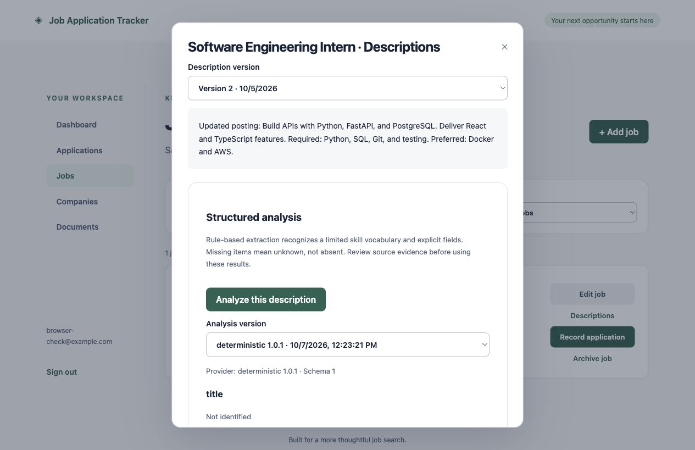

# Description extraction

Milestone 6 implements a deterministic provider, validated structured output,
source evidence, and persisted analysis versions. No paid API, LLM, scraping,
or external transmission is involved.

Open Jobs → Descriptions, select a raw description version, and choose
**Analyze this description**. The review screen includes unknown fields and
exact source quotes with zero-based, end-exclusive character offsets.

## API and preservation

- `GET /api/v1/descriptions/{id}/analyses`: authenticated paginated history.
- `POST /api/v1/descriptions/{id}/analyses`: CSRF-protected extraction.

All queries enforce ownership; missing and foreign descriptions return 404.
The service locks the immutable description row to serialize creation, validates
provider output with Pydantic and checks every quote against the raw text before
writing JSONB. Repeating the same provider/version/schema returns the existing
analysis (200); a new result returns 201. Different description or provider
versions remain separate. PostgreSQL already protects analysis updates with an
immutability trigger. No migration is needed.

## Provider contract and limitations

`Provider` exposes name, version, and `extract(text)`. The deterministic provider
uses explicit Title/Job title/Role, Company, and Location labels; known headings
for required/preferred skills and responsibilities; education terms; numeric
experience requirements; and a small versioned skill vocabulary.

Unclassified skill mentions are stored separately. Negation is handled
conservatively at line level; mixed clauses can therefore lose classification.
Unknown headings reset classification. Unrecognized skills, prose-only identity
fields, synonyms, complex education/experience language, and multilingual text
may be missed. Go is recognized only as Golang to avoid ordinary prose matches.
Keywords are recognized vocabulary terms, not a general keyword model.
Results are evidence-backed suggestions, not complete semantic understanding.
Missing values mean unknown, not that a requirement is absent. Extracted data
does not modify manually entered job metadata. Users should review the original
text before relying on extraction or future matching.

Changing extraction rules or vocabulary requires incrementing provider_version;
changing the output contract requires a schema-version change. A future LLM
provider must satisfy the same validation contract and evidence checks.

## Verification

60 backend tests pass, including section classification, Unicode/CRLF offsets,
word boundaries, negation, unknown fields, invalid provider evidence, immutable
analysis records, provider-version preservation, idempotent reruns, description
versions, and account isolation. Frontend TypeScript/build checks pass.

Browser verification confirmed extraction and preservation across provider versions.

