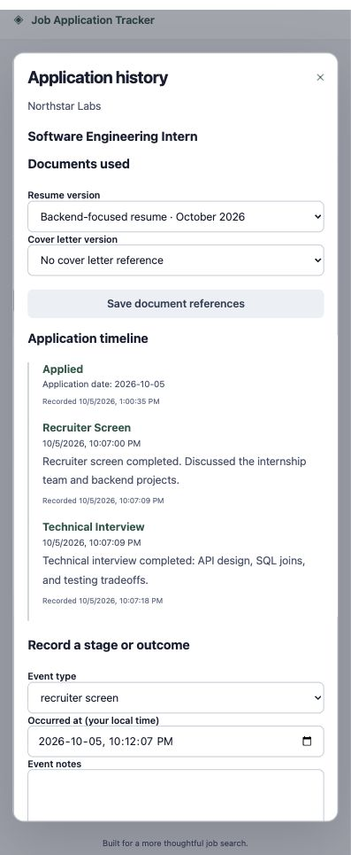

# Application history and documents

Implemented in milestone 4. All resources are scoped to the authenticated user;
mutations require the session-bound CSRF token and custom request header.

## API

| Resource | Operations |
| --- | --- |
| `/api/v1/applications/{id}/events` | GET paginated timeline; POST event, returning the updated application |
| `/api/v1/documents` | GET paginated list with archived filter; POST immutable version metadata |
| `/api/v1/documents/{id}` | GET; PATCH archived boolean for archive/restore |
| `/api/v1/applications/{id}` | PATCH notes, resume_id, and/or cover_letter_id |

Events are ordered by occurrence time, recording time, then UUID. The frontend
loads all timeline pages. New events distinguish when something occurred from
when it was recorded. The initial applied event represents a calendar date,
normalized to UTC midnight; the UI displays it as a date.

## Transition rules

Stage events support assessment, recruiter screen, technical interview,
behavioral interview, and final interview. Skips and repeated stages are allowed
because hiring processes vary. Offer, rejection, and withdrawal close an active
application while preserving its last stage. Closed applications accept notes.
Reopening and corrections are deferred until an explicit history policy exists.

Event input requires a timezone-aware timestamp, normalized to UTC. It must be
at or after the application date and no later than the current time. Future
appointments are not completed events. State-changing events must occur strictly
after the latest non-note event; equal timestamps are rejected. Notes require
nonempty text, may be backdated, and do not advance stage or outcome.

An application row lock serializes transitions. Event insertion and current-state
updates commit together; failure rolls both back. Concurrent submissions with the
same timestamp produce one success and one conflict. PostgreSQL triggers prevent
updates to existing events. Unknown and foreign-owned resources return 404.

## Document versions

Each record describes a resume or cover-letter version with a label, optional
version label, and opaque storage reference. Files are not uploaded, fetched,
or read from these references. Add a new record for a revised document; a database
trigger protects version metadata. Archive/restore remains reversible.

Attachment checks enforce ownership and document kind. Archived versions cannot
be newly attached; a reference already attached to an application may remain
there. Document locks serialize attachment validation against archive changes.
The UI preserves attached archived versions in its selectors.

## Verification

The backend suite has 50 passing tests, including chronology, terminal outcomes,
backdated notes, ownership, document role checks, immutable metadata, rollback,
and concurrent transitions against PostgreSQL. Migration downgrade/re-upgrade and
schema drift checks passed. Browser verification attached a resume reference and
recorded recruiter and technical interviews while preserving earlier events.

