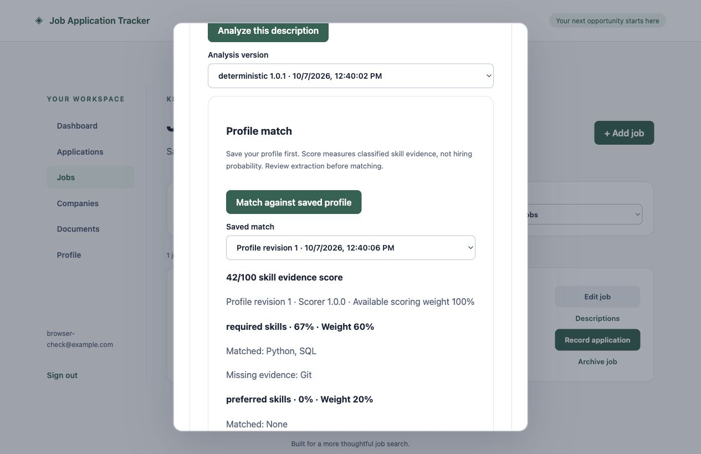

# Explainable matching

Milestone 7 adds an editable, revisioned profile and persisted deterministic
matches. No LLM, embeddings, external service, or resume file parsing is used.

## Workflow

Open **Profile**, enter skills, education, and projects/experience with explicit
skill tags, then save. Open **Jobs → Descriptions**, analyze the selected version,
and choose **Match against saved profile**. The result shows component scores,
matched/missing evidence, relevant entries, and skills to emphasize. Saved matches
remain selectable after profile changes. Education requirements are displayed
alongside profile education for manual review.

## Scoring version 1.0.0

- Required skill coverage: weight 60%.
- Preferred skill coverage: weight 20%.
- Project skill evidence against classified requirements: weight 10%.
- Experience skill evidence against classified requirements: weight 10%.

Coverage is distinct matched skills divided by distinct target skills. Required
skills take precedence over duplicate preferred skills. Normalization trims and
case-folds text and maps a small documented alias set (Postgres/PostgreSQL,
React.js/React, Golang/Go, Amazon Web Services/AWS). Skills explicitly tagged on
projects or experience also count as available skill evidence.

A component without extracted target requirements is unavailable. The overall
score renormalizes remaining weights; the UI displays the available weight. If
no requirements are classified, the overall score is unavailable. An empty
profile gives zero evidence coverage when requirements are known. No unclassified
skill mentions contribute to the score. Project/experience tags are self-reported,
and coverage does not validate proficiency or estimate hiring probability.

Education compatibility and experience duration are not scored: extraction
currently stores prose evidence rather than validated degree levels, fields,
or durations. Those aspects require manual review. This is a skill evidence score,
not a complete suitability assessment. Extraction omissions can materially affect
it, so review original source evidence first.

## Persistence, concurrency, and API

`GET /api/v1/profile` returns a profile or null. `PUT /api/v1/profile` accepts
`{revision, data}`; initial creation uses revision 0. A user-row lock serializes
creation, and revision checks reject stale updates with 409. Identical saves
retain their revision; changed saves increment it.

`POST /api/v1/analyses/{id}/matches` saves a result using the current locked
profile. `GET` on the same resource provides paginated history. Every run saves
an immutable result with profile revision, scorer version, extracted-data and
profile snapshots, component weights, and explanations. Existing PostgreSQL
triggers prevent result updates. Ownership is enforced throughout; foreign
analyses return 404. Mutations require CSRF. No migration is needed.

64 backend tests pass, including weighted calculations, aliases/deduplication,
unavailable requirements, empty profiles, project/experience evidence, profile
revision conflicts, immutable snapshots, and account isolation. Frontend build
and formatting pass. Degree scoring, semantic project relevance, and resume
uploads remain deferred rather than simulated.

Browser verification saved a profile with project tags, checked unavailable
requirements, and verified a populated score with matched/missing evidence.

