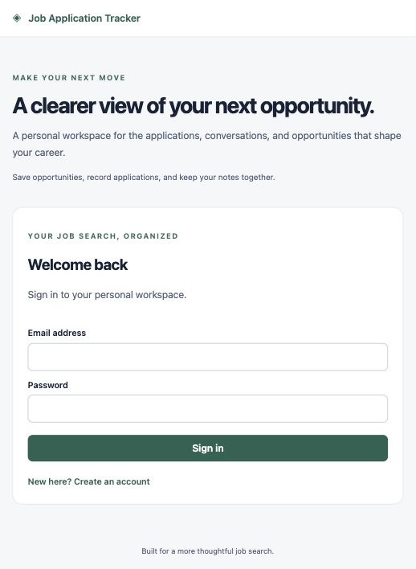

# Public HTTPS on the existing Lightsail instance

Public HTTPS deployed and verified on October 30, 2026 at
the configured deployment hostname and attached Lightsail static IP.
The live hostname and IP are intentionally omitted from this public repository
until additional public usage controls are implemented.
DNS A record, trusted Let's Encrypt certificate, HTTP-to-HTTPS redirect, readiness,
production secure/HttpOnly/host-only cookies, browser rendering, and complete
synthetic API smoke workflow passed. Existing database volume was preserved.

The following describes the active deployment and future reproduction. Use the existing project and database volume:

```sh
sudo docker compose -f compose.tunnel.yml -f compose.public.yml config --quiet
sudo docker compose -f compose.tunnel.yml -f compose.public.yml up -d
```

**Do not start the standalone production Compose project for this cutover:** it
uses a different database volume. The public override intentionally keeps the
current `job-tracker-tunnel` project and `tunnel_data` volume while enabling
production cookie settings and adding Caddy. Backup commands that exec the
existing database service remain valid.

Prerequisites: attach a stable IPv4 to the instance; choose an owned domain or a
free DuckDNS hostname; point its A record to the instance IP. Avoid a stale AAAA
record. Set `PUBLIC_HOSTNAME` in the server's existing private `.env` without
printing the database password. Its value is a hostname only, without protocol,
path, or port. Retain the existing database credentials.

Only after these checks, allow TCP 80 and 443 in Lightsail for certificate
issuance and HTTPS. Keep PostgreSQL, FastAPI, and frontend port 8080 off the public
firewall. Caddy redirects HTTP to HTTPS and manages certificates. DNS tokens are
not needed by this HTTP-challenge setup and should not be sent in chat.

Changing the server IP also requires updating the Mac backup LaunchAgent and
SSH tunnel destination. Verify the server host key for the new address. Check
that backup sync still works before treating the change as complete.

Before cutover, create a fresh encrypted backup. After deployment, verify DNS,
the valid certificate, redirect behavior, readiness, registration/login, secure
host-prefixed cookies, record persistence, and backup execution. Users must sign
in again because production uses different cookie names. The original localhost
HTTP login flow is no longer supported by the production API.

To roll back, close public firewall rules and apply only `compose.tunnel.yml`
with `--remove-orphans` to remove the edge service while retaining volumes. Do
not use `down --volumes`. The private development-cookie mode is only appropriate
for the SSH-tunnel path, never a publicly exposed HTTP service.

Free DNS depends on its provider; ownership/control is less durable than a
registered domain. An attached Lightsail static IP has no additional charge;
an unused detached address can incur charges. No load balancer, managed database,
or separate server is required for this small single-instance setup.


